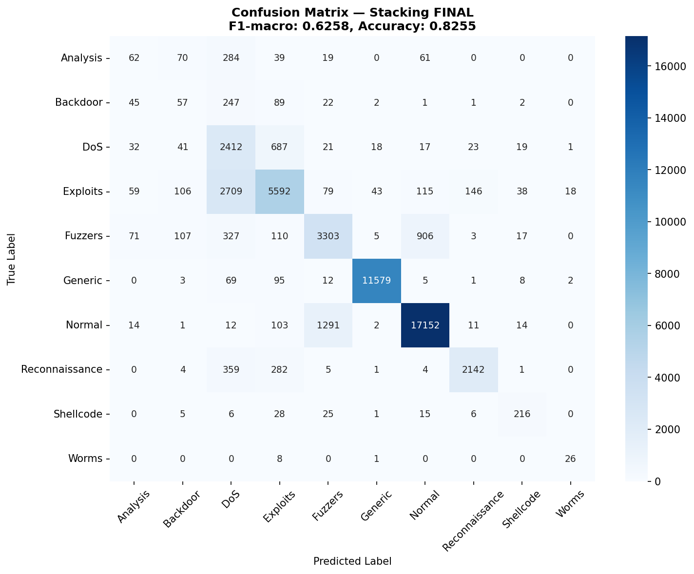
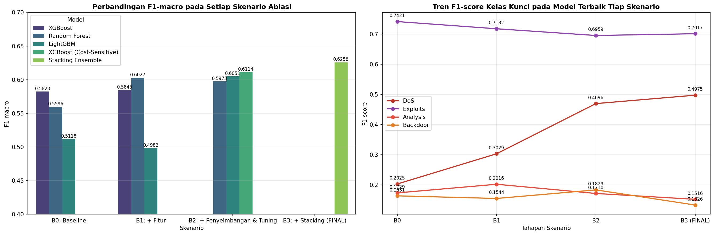
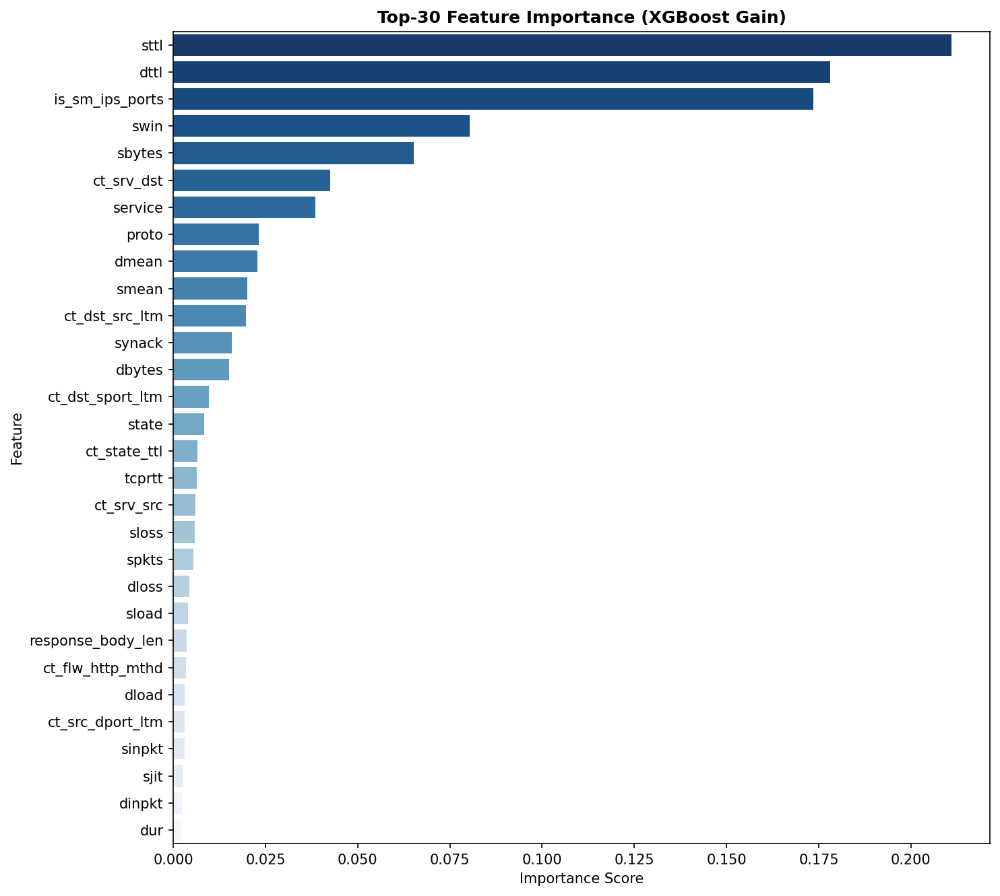
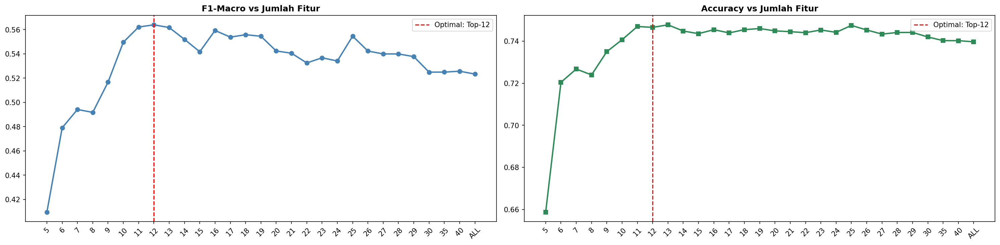

# UNSW-NB15 Multi-Class Network Intrusion Detection — Stacking Ensemble 10 Kelas

> **EN:** A 10-class network intrusion detection pipeline on UNSW-NB15 using a stacking ensemble (cost-sensitive XGBoost + Random Forest + LightGBM), staged SMOTE, confidence-weighted class weights, Optuna tuning, and an incremental ablation study.

Repositori ini berisi pipeline *machine learning* end-to-end untuk mendeteksi dan mengklasifikasikan **10 kategori lalu lintas jaringan** (Normal + 9 jenis serangan) pada dataset **UNSW-NB15**, termasuk kelas minoritas ekstrem seperti Worms (174 sampel) dan Shellcode.

**Hasil akhir:** Accuracy **0.8255**, F1-macro **0.6258**, AUC-ROC **0.9755**, FPR (macro) **0.0202** pada 20% data uji (51,535 sampel).

## Hasil utama

| Model | Accuracy | Precision (macro) | Recall (macro) | F1 (macro) | F1 (weighted) | AUC-ROC | FPR (macro) |
|---|---|---|---|---|---|---|---|
| XGBoost Standalone | 0.7792 | 0.5824 | 0.6712 | 0.5981 | 0.8043 | 0.9659 | 0.0240 |
| Random Forest Standalone | 0.7898 | 0.5823 | 0.6606 | 0.5973 | 0.8134 | 0.9608 | 0.0231 |
| LightGBM Standalone | 0.7936 | 0.5887 | 0.6670 | 0.6051 | 0.8142 | 0.9642 | 0.0227 |
| **Stacking FINAL** | **0.8255** | **0.6315** | **0.6414** | **0.6258** | **0.8316** | **0.9755** | **0.0202** |

**Performa per kelas (Stacking FINAL)**

| Kelas | Precision | Recall | F1 | Support |
|---|---|---|---|---|
| Analysis | 0.22 | 0.12 | 0.15 | 535 |
| Backdoor | 0.14 | 0.12 | 0.13 | 466 |
| DoS | 0.38 | 0.74 | 0.50 | 3271 |
| Exploits | 0.80 | 0.63 | 0.70 | 8905 |
| Fuzzers | 0.69 | 0.68 | 0.69 | 4849 |
| Generic | 0.99 | 0.98 | 0.99 | 11774 |
| Normal | 0.94 | 0.92 | 0.93 | 18600 |
| Reconnaissance | 0.92 | 0.77 | 0.83 | 2798 |
| Shellcode | 0.69 | 0.72 | 0.70 | 302 |
| Worms | 0.55 | 0.74 | 0.63 | 35 |

Kelas mayoritas dan kelas dengan pola yang jelas (Generic, Normal, Reconnaissance) terdeteksi baik. Kelas **Analysis, Backdoor, dan DoS** tetap sulit karena tumpang tindih fitur dengan Exploits; analisis diagnostiknya ada di repositori pendamping ([lihat di bawah](#proyek-terkait)).



## Studi ablasi (4 tahap)

Setiap tahap menambahkan komponen pada tahap sebelumnya dan dievaluasi pada data uji yang sama.

| Tahap | Komponen |
|---|---|
| **B0** | Baseline: 3 model standalone, parameter default, 42 fitur mentah, tanpa penyeimbangan kelas |
| **B1** | + Seleksi dan rekayasa fitur (31 fitur) |
| **B2** | + Penyeimbangan (SMOTE bertahap, class weight, cost-sensitive) dan tuning Optuna |
| **B3** | + Stacking ensemble dan threshold tuning Fuzzers–Normal (pipeline final) |

| Skenario | Model | Acc | F1-macro | AUC-ROC | F1 DoS | F1 Exploits | F1 Analysis | F1 Backdoor |
|---|---|---|---|---|---|---|---|---|
| B0: Baseline | XGBoost | 0.8325 | 0.5823 | 0.9709 | 0.2025 | 0.7421 | 0.1729 | 0.1631 |
| B0: Baseline | Random Forest | 0.8263 | 0.5596 | 0.9067 | 0.2906 | 0.7178 | 0.2136 | 0.1466 |
| B0: Baseline | LightGBM | 0.8160 | 0.5225 | 0.8994 | 0.1829 | 0.7306 | 0.1540 | 0.1413 |
| B1: + Fitur | XGBoost | 0.8314 | 0.5845 | 0.9702 | 0.1925 | 0.7423 | 0.1512 | 0.1705 |
| B1: + Fitur | Random Forest | 0.8289 | 0.6027 | 0.9099 | 0.3029 | 0.7182 | 0.2016 | 0.1544 |
| B1: + Fitur | LightGBM | 0.7968 | 0.4982 | 0.8694 | 0.2256 | 0.7108 | 0.0954 | 0.1285 |
| B2: + Penyeimbangan & Tuning | XGBoost (Cost-Sensitive) | 0.8177 | 0.6114 | 0.9686 | 0.4696 | 0.6959 | 0.1710 | 0.1829 |
| B2: + Penyeimbangan & Tuning | Random Forest | 0.7898 | 0.5973 | 0.9608 | 0.4335 | 0.6725 | 0.1066 | 0.0808 |
| B2: + Penyeimbangan & Tuning | LightGBM | 0.7936 | 0.6051 | 0.9642 | 0.4636 | 0.6730 | 0.1224 | 0.0904 |
| B3: + Stacking (FINAL) | Stacking Ensemble | 0.8255 | 0.6258 | 0.9755 | 0.4975 | 0.7017 | 0.1516 | 0.1326 |



Hal yang perlu diperhatikan saat membaca tabel:
- Kenaikan F1-macro terbesar terjadi pada B1 → B2, terutama dari F1 kelas DoS (≈0.19 → 0.47). Tahap B2 mengubah beberapa komponen sekaligus, jadi kenaikannya adalah kontribusi **paket** komponen, bukan satu teknik saja.
- Baseline default terbaik adalah Random Forest pada B1 (F1-macro 0.6027), sehingga peningkatan pipeline final terhadap baseline terkuat adalah sekitar +0.023.
- F1 kelas Analysis dan Backdoor pada model final (0.1516 dan 0.1326) tidak lebih baik daripada baseline B0 (0.1729 dan 0.1631). Perbaikan lebih nyata pada DoS dan pada F1-macro secara agregat.
- Accuracy model final (0.8255) sedikit di bawah baseline B0 XGBoost (0.8325); pipeline dioptimalkan untuk F1-macro.
- Tahap B3 menggabungkan stacking dan threshold tuning, sehingga kontribusi keduanya tidak terpisah.

## Metodologi

**Data.** `UNSW_NB15_training-set.csv` (175,341 baris) dan `UNSW_NB15_testing-set.csv` (82,332 baris) digabung menjadi 257,673 baris, 42 fitur, 10 kelas, lalu dibagi ulang *stratified* 80:20 (206,138 latih / 51,535 uji), seed `42`. `MinMaxScaler` di-fit hanya pada data latih. `proto`, `service`, dan `state` di-encode dengan `LabelEncoder`.

**Seleksi dan rekayasa fitur (31 fitur).**
1. Peringkat fitur dengan XGBoost feature importance (gain); jumlah fitur dipilih dari 29 variasi Top-N dengan Random Forest sederhana. Hasilnya **Top-12**: `sttl`, `dttl`, `is_sm_ips_ports`, `swin`, `sbytes`, `ct_srv_dst`, `service`, `proto`, `dmean`, `smean`, `ct_dst_src_ltm`, `synack`.
2. Enam fitur ditambahkan paksa untuk deteksi DoS: `dur`, `spkts`, `dpkts`, `rate`, `ct_src_ltm`, `ct_src_dport_ltm` (total 18).
3. Sepuluh fitur rekayasa (rasio byte/paket/mean/load, laju paket dan byte per durasi, `dur_x_rate`, `payload_asym`, `port_scan_ratio`, `response_ratio`), total 28.
4. Tiga fitur tambahan: `trans_depth`, `ct_flw_http_mthd`, `ct_srv_src`, total **31**.

**SMOTE bertahap (hanya pada data latih).** DoS → 20,000 (k=3); Fuzzers → 22,000 dan Reconnaissance → 16,000 (k=5); Shellcode dan Worms ×6 (k=2); Analysis dan Backdoor ×6 (k=3). Data latih menjadi 247,235 sampel.

**Pembobotan kelas dua lapis.** Bobot dasar per kelas (Normal/Generic 1.0, Reconnaissance/Exploits 2.0, Fuzzers 2.5, DoS 4.0, Analysis/Backdoor 15.0, Shellcode/Worms 30.0) dikalikan faktor *confidence* dari prediksi out-of-fold XGBoost 5-fold (rentang [0.8, 1.5]; [0.9, 1.2] untuk Shellcode, Worms, Analysis, Backdoor).

**Tuning hyperparameter.** Optuna (TPE, seed 42) memaksimalkan F1-macro dengan CV 3-fold pada subsampel 40,000 sampel hasil SMOTE: XGBoost 30 trial, Random Forest 25 trial, LightGBM 25 trial.

**Model.** *Stacking* dengan tiga base learner: **XGBoost cost-sensitive** (custom objective dengan matriks biaya untuk klaster Analysis, Backdoor, DoS, Exploits; penalti 2.0–4.0), Random Forest, dan LightGBM. Meta-learner XGBoost (`n_estimators=500`, `max_depth=5`, `learning_rate=0.05`), `cv=3`, `passthrough=True`.

**Post-processing.** *Threshold* pasangan Fuzzers–Normal (θ = 0.40, dicari pada grid 0.10–0.90) untuk menyeimbangkan precision dan recall kedua kelas.




## Struktur repositori

```
UNSW-NB15-Multi-Class-Intrusion-Detection/
├── README.md
├── LICENSE
├── requirements.txt
├── .gitignore
├── data/
│   └── README.md                          # cara memperoleh dataset (CSV tidak di-commit)
├── notebooks/
│   └── Pipeline_10Kelas_perbaikan_ablasi.ipynb   # pipeline lengkap + studi ablasi
└── results/
    ├── metrics/
    │   ├── hasil_evaluasi_model_10kelas.csv
    │   └── studi_ablasi_4_tahapan.csv
    ├── figures/                           # confusion matrix, feature importance, tren ablasi
    └── ablation/                          # confusion matrix dan classification report tiap skenario
```

## Cara menjalankan

1. Gunakan Python 3.10, lalu pasang dependensi:
   ```bash
   python -m venv .venv
   source .venv/bin/activate        # Windows: .venv\Scripts\activate
   pip install -r requirements.txt
   ```
2. Unduh dataset sesuai [`data/README.md`](data/README.md) dan letakkan di `data/raw/`.
3. Buka `notebooks/Pipeline_10Kelas_perbaikan_ablasi.ipynb` dan **ubah `DATA_DIR`** pada sel 2 agar menunjuk ke `data/raw/` (nilai bawaan masih path lokal penulis).
4. Jalankan seluruh sel secara berurutan. Notebook menyimpan gambar di direktori kerja dan hasil ablasi di folder `ablasi_output/`; file-file yang sama sudah disertakan di `results/`.

> Notebook dengan output tersimpan sudah disertakan, sehingga hasil dapat dilihat tanpa melatih ulang.

## Keterbatasan

- **Jumlah fitur (Top-12) dipilih dengan skor pada data uji** (sel 7), sehingga skor uji berpotensi sedikit optimistis. Idealnya pemilihan memakai validasi atau CV pada data latih.
- **Threshold Fuzzers–Normal dituning pada validation split yang diambil dari data latih, tetapi model stacking dilatih dengan seluruh data latih** (termasuk sampel validasi dan turunan sintetiknya). Validasi tersebut tidak sepenuhnya independen.
- **SMOTE dijalankan sebelum validasi silang** pada tuning Optuna dan stacking, sehingga skor CV lebih tinggi dari skor uji (CV F1-macro 0.70–0.72 vs uji 0.60 untuk model standalone).
- **Data gabungan lalu di-split acak.** Split resmi UNSW-NB15 tidak dipakai dan tidak ada pengecekan duplikat, sehingga hasil tidak sebanding langsung dengan studi yang memakai split resmi.
- `LabelEncoder` pada fitur kategorikal yang kemudian disintesis SMOTE dapat menghasilkan nilai kategori non-integer.
- Studi ablasi bersifat inkremental per paket komponen (lihat catatan di bagian ablasi) dan memakai satu split serta satu seed, tanpa interval kepercayaan.

## Proyek terkait

[**unsw-nb15-hierarchical-decomposition**](https://github.com/aiiiss/unsw-nb15-hierarchical-decomposition): eksperimen diagnostik yang menguji apakah klaster Analysis, Backdoor, DoS, dan Exploits dapat dipisahkan dari kelas lain (7 kelas) dan satu sama lain (4 kelas).

## Referensi

- Moustafa, N. & Slay, J. (2015). *UNSW-NB15: a comprehensive data set for network intrusion detection systems.* Military Communications and Information Systems Conference (MilCIS).

## Lisensi

Kode dirilis di bawah lisensi MIT (lihat [`LICENSE`](LICENSE)). Dataset UNSW-NB15 **tidak** disertakan dan tunduk pada ketentuan penyedia aslinya.
